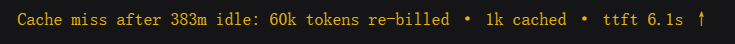

# dsh-cache-miss


[](https://www.dsh.so/artifact/dsh-cache-miss/)
[](https://dshbase.com/zh/plugins/dsh-cache-miss/)

[English](README.en.md)

DSH 网页插件：在一轮的**第一条 assistant 回复**正下方，以一条黄色单行提示该轮首次请求的提示缓存未命中（prompt cache miss）。

## 功能

一轮 Agent 对话是 `assistant -> tool -> assistant -> tool ...`。该轮**第一次**模型调用正是供应商提示缓存可能已过期、需要整段重新 prefill（重建缓存）的时机；同轮后续调用往往命中刚重建的缓存。DSH 自带的 token/缓存统计在输入框下方，产物文件行在轮尾，都无法在 miss 真正发生的位置就地提示。

本插件在轮首第一条 assistant 回复正下方，仅当该请求确为缓存未命中时渲染一条黄色单行：

```
Cache miss after 3m idle · 182k tokens re-billed (turn ~$0.027) · 0.8k cached · ttft 2.1s ↑ · (tools changed) · session used (~$2.90)
```


- `idle` —— 距上一轮结束的空闲时长。
- `re-billed` —— 该请求未命中缓存的输入 token 数（缩写为 k）。
- `(turn ~$…)` / `(step ~$…)` —— 被重建的那部分上下文的近似金额：轮首请求 miss 标 `turn`（整段上下文重建），
  轮中某步 miss 标 `step`（只有该步改动的前缀重建），同一轮两者都重建过就直接给合计 `(~$…)`；`~` 明示估算。
- `cached` —— 同一 prefill 中命中缓存的部分（provider 回报时显示），让“重算量 vs 命中量”一目了然。
- `ttft` —— 首 token 时延（取自 assistant timing，可用时显示）；上箭头示意重建 prefill 通常更慢。
- `(system prompt changed)` / `(tools changed)` —— 核心对本次请求的**前缀变更分类**，写成人话而不是照抄枚举名
  （系统提示 / 工具目录都属于缓存前缀，任一处变了都会让之后全部重算，所以这是 miss 最常见的原因）。
  分类由核心给出，插件只转述。
- `(config changed)` —— 请求头里的 config 变了（provider 切换、reasoningEffort 等）。不同配置就是不同缓存命名空间，
  整段 prompt 重算；核心分类不覆盖这一项，由插件在同一份规范化 config 上做等值比较补上，可与分类叠加。
- `session used (~$…)` —— 会话已用量（已载入窗口口径的近似金额），`used` 标明这是累计而不是本次。

价格取自 [models.dev](https://models.dev/api.json) 的 DeepSeek 价目，直接按它的美元单价显示（不做汇率换算，`~` 明示估算）。随包快照只作离线兜底；实时价目按需取、**24 小时有效**：过期后下次加载刷新一次，模型切换时刷新一次，遇到快照里查不到的模型（新模型、relay 换了拼写）也刷新一次——所以调价和新模型都不用等插件发版。取不到（离线、请求失败）就继续用手上的价目，匹配不到就只省略金额，不编价格。峰谷/节假日这类分时价是单一供应商的定价策略，插件不写死。金额只算 prompt 部分（未命中输入 + 命中缓存读），不含输出 token。

纯前端展示：不写入 session log，不修改 DSH 源码，也不占用 turn-tail 链，因此不会与产物文件行冲突（例如 `DSH-better-sidebar`）。

## 缓存与花费

**命中缓存与未命中的输入 token，单价差 30–50 倍**（models.dev 2026-10 价目，美元 / 1M token）：

| 模型 | 未命中输入 (`input`) | 命中缓存 (`cache_read`) | 倍数 |
| --- | --- | --- | --- |
| `deepseek-v4-flash` | 0.15 | 0.003 | **50×** |
| `deepseek-v4-pro` | 0.66 | 0.022 | **30×** |

一次 miss 重算 448k token，按 flash 算是 ~$0.067，命中则只要 ~$0.0013。**prompt 的省钱全靠命中率**，而命中率由前缀决定。

### 为什么前缀一变就全贵了

DeepSeek 的前缀缓存要求**从第一个 token 起逐字节一致**。系统提示、工具目录、请求 config（provider / reasoningEffort 等）都属于前缀——任意一处变了，变化点之后的 token 全部按未命中计费。实测里真正的 miss 几乎都来自前缀变更，而不是缓存过期——空闲 27 分钟后下一轮仍然命中过（缓存 TTL 比直觉长，具体由服务端决定）。

### 插件会显示这样几段

- `22k tokens re-billed` —— 这次请求**重算**的部分，也就是多花的钱；
- `(turn ~$…)` / `(step ~$…)` —— 这笔钱花在整轮上下文重建上，还是只花了某一步改动的前缀；两者都发生则给合计；`session used (~$…)` 是会话累计；
- `(system prompt changed)` / `(tools changed)` / `(config changed)` —— 直接点出是谁破坏了前缀。

### 于是可以这么省

1. **别在会话中途改工具集或加载插件**：每次装/卸插件都会改工具目录与系统提示，下一次请求整段重算。要试新插件，换一个新会话试，别在长会话里反复装卸。
2. **切换 provider / 模型 / reasoningEffort 之后，不要指望接着命中**：那是新的缓存命名空间，整段全价。
3. **长会话接着用比新开窗口便宜**：缓存还在，下一轮基本只付增量；新开窗口 = 冷启动，首轮全价。
4. **少改会话中途会进入前缀的东西**（项目说明、系统提示类内容）：改一次，之后全部重算。

### 什么时候新开会话，什么时候 `/compact`

两条路都要付一次"重建"，区别在换到了什么：

- **继续做同一件事、只是上下文太长** → 用 `/compact`。压缩会重写历史，下一轮整段重算（插件会把那行标出来），但之后前缀重新稳定、每轮只付增量，任务线索还在。
- **换任务、方向已经走偏、或者准备装卸插件/改工具集** → 新开会话。新会话首轮是冷启动（插件不把它算作 miss），与其付"重写历史"那一次，不如换成干净的上下文，也不会被旧前缀的后续变更继续拖累。
- **任务没变、上下文也不长** → 两条都别选。接着用最便宜，缓存还在。

一句话：`/compact` 买的是"继续"，新会话买的是"重来"；都要付一次重建，所以别频繁做。

### 数字口径

金额只算 **prompt**（未命中输入 + 命中缓存读），不含 output token；单价来自 models.dev 的美元价目，`~` 明示是估算，实际扣费以官方账单为准。

## miss 判定

`inputTokens` 是"未命中缓存的输入"（disjoint 口径），`cacheReadTokens` 是同一 prefill 中命中的部分，因此缓存命中率 `hitRatio = cacheReadTokens / (inputTokens + cacheReadTokens)`。一个请求同时满足以下三条才算 miss：

- `inputTokens > 0`；
- `hitRatio < 80%`（超过 20% 的输入未命中——因为上下文是累积的，这部分绝对量已经不小）；
- `inputTokens >= 1000`（至少有 1k token 真正被重新计费）。

回 usage 但不回 cache 字段的 provider，在从未见过该 provider 的任何 cache 字段前，插件无法区分「完全 miss」与「命中但不报 cache 明细」：此时不把它误报成 miss，而是渲染一条灰色提示 `Provider reports no cache fields — cannot confirm cache status`。每个这样的 provider 首次出现时提示一次，切换到另一个这样的 provider 会再次提示；控制台同步输出每个 provider 一次更详细的 warning。一旦该 provider 出现过任一 cache 字段，后续无字段的请求按完全 miss 正常显示黄色 miss。完全不回 usage 的 provider 保持静默（不产生任何提示）。正常续写（命中率 ≥ 80%）保持静默；`re-billed` 只显示未命中的 `inputTokens`。

miss 数据取自流中的 `usage` chunk（adapter 在终止 finish 之前就会发出），因此提示在 usage 到达时就出现（回复仍在生成中），不必等到 assistant 消息结束。每步在浏览器控制台输出一次，时间戳按浏览器本地时区。

## 安装

```sh
dsh plugin --profile web add dsh-cache-miss
```

重启 `dsh web`（或硬刷新正在运行的 GUI）以加载 client bundle。

## 已知限制

- TTFT 是 step 的 `step/start` 事件到首个非空 token delta 事件的墙钟间隔，取自会话事件时间；当任一边界落在已加载窗口之外时视为缺省（不显示 `· ttft ...` 段）。
- 节点对每个 assistant step 都会发布，但命中时渲染为空，因此命中轮不产生可见行；每一步至多输出一条控制台日志。
- 从未出现 cache 字段的 provider 首次出现时显示一次灰色“无法确认”提示，不做启发式猜测——TTFT 受网络/负载影响，无法可靠区分"cache miss 导致慢"与"本来就慢"。


